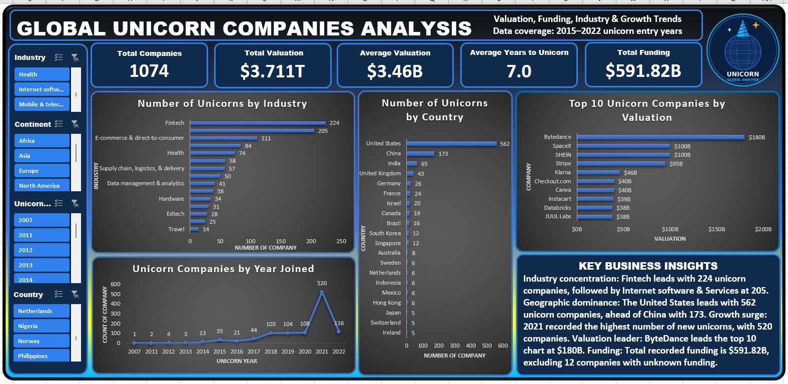

# GLOBAL-UNICORN-COMPANIES-ANALYSIS-EXCEL-DASHBOARD
🚀 PROJECT COMPLETED: GLOBAL UNICORN COMPANIES ANALYSIS | EXCEL DASHBOARD

# Global Unicorn Companies Analysis

**Tool:** Microsoft Excel | Data Cleaning | Formulas | PivotTables | PivotCharts | KPI Cards | Slicers | Dashboard Design

## Project Overview
What makes a startup worth billions of dollars? 🌍🦄

This interactive Excel dashboard explores the world of unicorn companies, which are privately owned startups valued at $1 billion or more. Using data on 1,074 unicorn companies, it turns raw data into clear insights on where these companies come from, which industries they operate in, how their valuations compare, and how the unicorn landscape has changed over time.

## Project Demo
🎥 [Watch the dashboard walkthrough on LinkedIn](https://www.linkedin.com/posts/udokanma-anthony-nyenke-99864b412_dataanalytics-microsoftexcel-exceldashboard-activity-7518968368784257024-h6IB)

## Dashboard Preview

## Dataset
Data on **1,074** unicorn companies worldwide.

## What You Can Discover
- **Industry insights:** Which industries have the most unicorn companies?
- **Geographic distribution:** Which countries are home to the highest number of unicorns?
- **Growth trends:** In which year did the most companies achieve unicorn status?
- **Company valuations:** Which unicorns rank among the most valuable?
- **Funding analysis:** How much funding have these companies raised, based on available data?

## Interactive Features
Slicers let users filter the whole dashboard by:
- Industry
- Continent
- Year
- Country

Select different categories and the numbers and visualizations update instantly.

## Tools Used
Microsoft Excel: data cleaning, formulas, PivotTables, PivotCharts, KPI cards, slicers, and dashboard design.

## Goal
To turn complex data into clear, useful information that anyone can understand and use to explore business trends.

## Skills Demonstrated
Data cleaning, PivotTables and PivotCharts, KPI design, interactive dashboard building, data visualization, and data storytelling.

## Author
**Udokanma Anthony Nyenke**
Data Analyst | Excel, Power BI, SQL, Python, Tableau
GitHub: [UdokanmaNyenke](https://github.com/UdokanmaNyenke)
